# SAGE: modelado (procesos, casos de uso y diagramas) v1

Universidad Privada del Valle · Proyecto SAGE · Borrador del 19/10/2026
Base: `SAGE_IoT_diseno_v1.md`, *Proyecto_SAGE_BPMN_AS-IS_TO-BE.pdf* (del grupo) y *Modelo_de_Negocio_SAGE_Ampliado.docx* (del compañero).

Los diagramas están escritos en **PlantUML**. Se pueden ver en <https://www.plantuml.com/plantuml> o con la extensión PlantUML de VS Code, y sirven como guía para redibujarlos en StarUML. Los BPMN están escritos como diagramas de actividad con carriles. En la herramienta BPMN que usó el grupo se dibujan con la notación oficial: pools, carriles, eventos y compuertas.

---

## 0. Revisión del documento del compañero

**Qué es:** un *Business Model Canvas* del SAGE **anterior**, el que solo trabaja con facturas, simulación y reportes. Está bien redactado y es honesto: presenta los ingresos y las alianzas como hipótesis, no como hechos.

**Problemas para lo que se pide ahora**

1. **Responde a otra pregunta.** En este curso, "modelo de negocio actual y propuesto" está junto a "Diagrama BPMN" en la diapositiva. Se refiere al **proceso de negocio AS-IS y TO-BE**, no al Canvas. El Canvas es un análisis comercial válido, pero no reemplaza ese entregable.
2. **No menciona el dispositivo IoT ni el control de fuentes**, que es justamente lo que se agregó para que el proyecto no fuera "un CRM".
3. Ese AS-IS/TO-BE **ya existe** en el PDF del grupo. La sección 2 del Canvas lo resume, pero no lo amplía.

**Qué se aprovecha:** casi todo el Canvas, si se actualizan estos bloques:

| Bloque | Cambio necesario |
|---|---|
| Propuesta de valor | Agregar **medición real por fuente y control de la fuente que alimenta la carga**, manual y automático |
| Recursos clave | Agregar hardware (ESP32, sensores, selector), firmware y procedimiento de calibración |
| Actividades clave | Agregar armado, instalación y calibración de dispositivos, y soporte de campo |
| Ingresos (hipótesis) | Agregar venta o alquiler del dispositivo, además de la suscripción |
| Costos | Agregar costo unitario de hardware, instalación y reposición |
| Aliados | Las instaladoras pasan a ser también instaladoras del dispositivo; agregar proveedores de componentes |
| Riesgos | Seguridad eléctrica, y el salto de la maqueta en continua a instalaciones reales en alterna (fuera del alcance de la v1) |

**Conclusión:** el Canvas se conserva como anexo comercial con esas actualizaciones. Los entregables de modelado son los de este documento.

---

## 1. Modelo de negocio actual (AS-IS)

Se divide en dos procesos.

### 1.1 AS-IS A: control de consumo y evaluación de alternativas

**Se mantiene sin cambios el diagrama del PDF del grupo** (pools: Empresa cliente con Administración/Contabilidad y Gerencia, y Proveedor solar; problemas 1 a 6). Se reproduce como referencia:

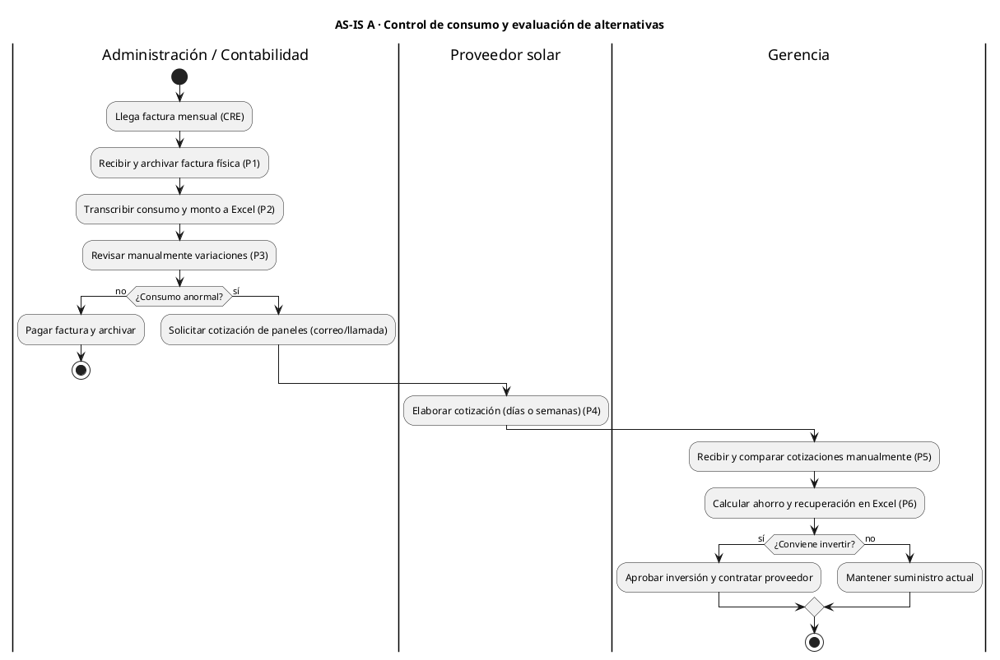

### 1.2 AS-IS B: operación diaria del suministro (nuevo)

El proceso A solo mira la factura mensual. No dice **qué fuente** usa cada carga, cuánta energía aporta cada una ni qué pasa cuando una falla. Este proceso cubre ese vacío. Representa a una empresa que **ya tiene** solar y red, o que está evaluando instalarla.

> **Supuesto del equipo, no validado en campo:** el proceso describe la práctica habitual. Antes de la defensa conviene confirmarlo con al menos una empresa o instaladora.

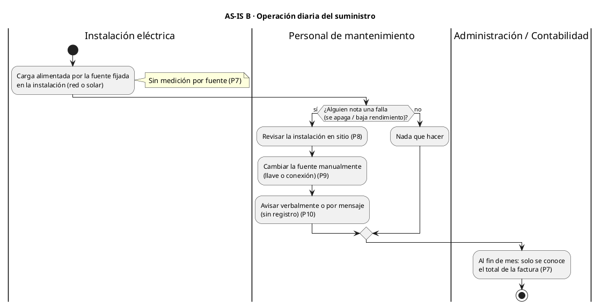

### 1.3 Problemas identificados (continuación de la numeración del grupo)

| N.º | Problema | Tipo |
|---|---|---|
| 1 a 6 | (Del PDF del grupo, sin cambios) | — |
| 7 | No se sabe cuánta energía entrega cada fuente; solo se ve el total mensual | Falta de información |
| 8 | Las fallas se descubren tarde, cuando alguien las nota | Cuello de botella |
| 9 | El cambio de fuente es manual y depende de que haya personal en sitio | Automatizable |
| 10 | No queda registro de cuándo ni por qué cambió la fuente | Sin trazabilidad |

---

## 2. Modelo de negocio propuesto (TO-BE)

### 2.1 TO-BE A: análisis y evaluación (actualiza el TO-BE del grupo)

Se conserva el diagrama del grupo, con **dos cambios**:

1. "Validar datos y actualizar historial" también incorpora la **energía medida por el dispositivo** cuando existe, sin mezclarla con la facturada.
2. "Comparar red, solar y mixto" puede usar el **perfil medido** como dato de entrada, y siempre rotula el resultado como **SIMULACIÓN**.

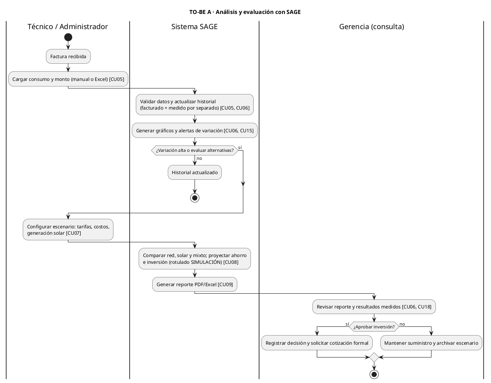

### 2.2 TO-BE B: monitoreo y control de fuentes (nuevo)

Resuelve los problemas 7 a 10.

```plantuml
@startuml TO-BE_B
title TO-BE B · Monitoreo y control de fuentes con SAGE
|Dispositivo SAGE|
start
:Medir V, I, P por fuente (10 Hz)
y acumular Wh [CU14];
note right: Resuelve P7
:Evaluar reglas del modo activo [CU14];
if (¿La fuente seleccionada dejó de ser válida?) then (sí)
  :Conmutar a la otra fuente y
  registrar evento con motivo [CU14];
  note right: Resuelve P8, P9 y P10
else (no)
endif
:Enviar telemetría y eventos cada 2 s [CU13];
|Sistema SAGE|
:Guardar mediciones y eventos;
evaluar alertas [CU13, CU16];
:Mostrar estado en tiempo casi real [CU10];
|Técnico / Administrador|
if (¿Alerta o se desea otro modo?) then (sí)
  :Revisar alerta [CU15];
  :Ordenar modo Solar / Cargador / Auto [CU11];
  |Sistema SAGE|
  :Entregar orden en la siguiente telemetría [CU13];
  |Dispositivo SAGE|
  :Ejecutar o rechazar con motivo;
  |Sistema SAGE|
  :Mostrar resultado de la orden [CU11];
else (no)
endif
stop
@enduml
```

### 2.3 Comparación AS-IS frente a TO-BE (solo proceso B)

| Aspecto | AS-IS B | TO-BE B |
|---|---|---|
| Energía por fuente | Desconocida | Medida en Wh por fuente |
| Detección de fallas | Cuando alguien la nota | Automática, en ≤ 2 s, y alerta en la plataforma |
| Cambio de fuente | Manual, en sitio | Automático local, o remoto desde la app con confirmación |
| Registro | Ninguno | Evento con fecha y hora, origen y motivo |
| Sin internet | — | El dispositivo sigue aplicando sus reglas (RNF07) |

---

## 3. Casos de uso

### 3.1 Actores

| Actor | Tipo | Descripción |
|---|---|---|
| **Consulta** | Humano | Ve monitoreo, historial, alertas y reportes. Es el rol de la Gerencia |
| **Técnico** | Humano | Hereda de Consulta. Registra consumos, simula, controla dispositivos y hace ensayos |
| **Administrador** | Humano | Hereda de Técnico. Gestiona empresas, usuarios, dispositivos y tarifas |
| **Dispositivo SAGE** | Sistema (ESP32) | Mide, conmuta y sincroniza con la plataforma |
| **Reloj del sistema** | Temporizador | Dispara verificaciones periódicas (dispositivo sin conexión, órdenes expiradas) |

> **[D] Pendiente:** RF01 ("registrar empresas") supone a alguien por encima de cada empresa. La propuesta es que el **Administrador** sea el operador de SAGE y gestione todas las empresas, y que Técnico y Consulta pertenezcan a una sola. Si se quiere que cada empresa tenga su propio administrador, hace falta un cuarto rol, "Superadministrador".

### 3.2 Lista de casos de uso

| CU | Nombre | Actor principal | Requisitos | Prioridad |
|---|---|---|---|---|
| CU01 | Iniciar sesión | Consulta (y herederos) | RNF01 | Must |
| CU02 | Gestionar empresas | Administrador | RF01 | Must |
| CU03 | Gestionar usuarios y roles | Administrador | RF02 | Must |
| CU04 | Registrar dispositivo | Administrador | RF09, RNF08 | Must |
| CU05 | Registrar consumo facturado | Técnico | RF03 | Should |
| CU06 | Consultar historial | Consulta | RF04 | Must |
| CU07 | Configurar parámetros económicos | Administrador | RF05, RNF06 | Should |
| CU08 | Simular y comparar escenarios | Técnico | RF06, RF07 | Should |
| CU09 | Exportar reporte | Consulta | RF08 | Could |
| CU10 | Monitorear dispositivo | Consulta | RF10, RF14 | Must |
| CU11 | Cambiar modo de fuente | Técnico | RF11 | Must |
| CU12 | Configurar reglas de conmutación | Técnico | RF15 | Should |
| CU13 | Sincronizar telemetría y órdenes | Dispositivo SAGE | RF10, RF11, RF13, RF14 | Must |
| CU14 | Conmutar fuente automáticamente | Dispositivo SAGE | RF12, RF13, RNF07 | Must |
| CU15 | Atender alertas | Técnico (ve también Consulta) | RF16 | Should |
| CU16 | Detectar pérdida de comunicación | Reloj del sistema | RF16 | Should |
| CU17 | Registrar ensayo | Técnico | RF17 | Should |
| CU18 | Comparar fuentes medidas | Consulta | RF18 | Could |

### 3.3 Diagrama de casos de uso

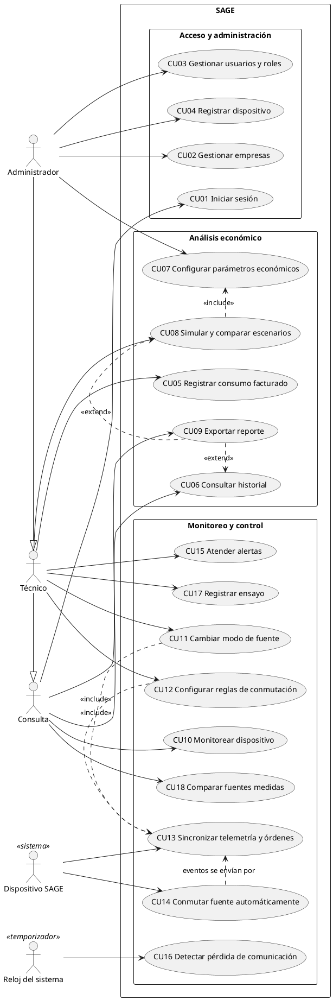

> Iniciar sesión (CU01) es **precondición** de todos los casos humanos. No se dibuja con `<<include>>` hacia cada uno porque llena el diagrama sin aportar información.

---

## 4. Especificación y diagramas por caso de uso

Convenciones de los diagramas de secuencia: `boundary` = pantalla, `control` = controlador del backend, `entity`/`database` = datos.

### CU01 · Iniciar sesión

| | |
|---|---|
| **Actor** | Usuario (Consulta, Técnico o Administrador) |
| **Precondición** | El usuario existe y está activo |
| **Flujo básico** | 1. Ingresa su correo y contraseña. 2. El sistema verifica el hash de la contraseña. 3. Crea la sesión. 4. Muestra el panel según su rol y empresa |
| **Alternos** | 2a. Credenciales inválidas: mensaje genérico. 2b. Cinco intentos fallidos: bloqueo de 15 min [P]. 2c. Usuario inactivo: acceso denegado |
| **Postcondición** | Sesión activa con rol y empresa |

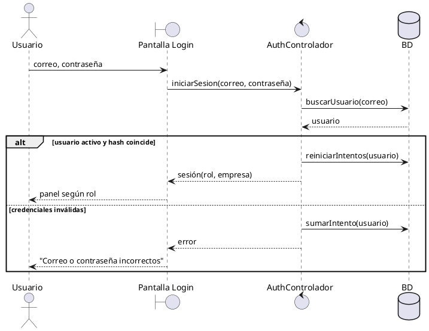

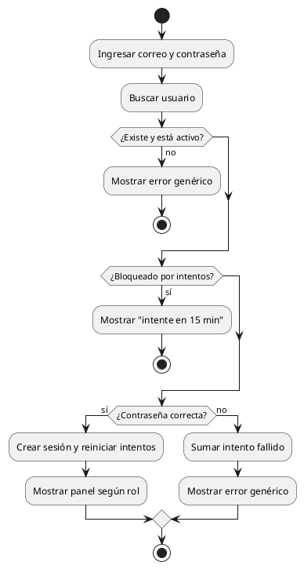

### CU02 · Gestionar empresas

| | |
|---|---|
| **Actor** | Administrador |
| **Flujo básico** | 1. Abre Empresas. 2. Elige crear o editar. 3. Ingresa razón social, NIT, rubro, ciudad y contacto. 4. El sistema valida (campos obligatorios, NIT único). 5. Guarda y confirma |
| **Alternos** | 4a. NIT duplicado o campo vacío: se marca el campo. 2a. Desactivar empresa: sus usuarios pierden acceso y sus datos se conservan |
| **Postcondición** | Empresa creada o actualizada |

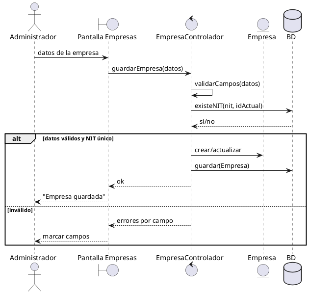

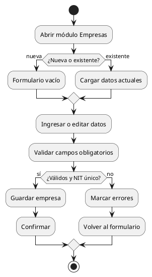

### CU03 · Gestionar usuarios y roles

| | |
|---|---|
| **Actor** | Administrador |
| **Flujo básico** | 1. Elige empresa. 2. Crea o edita un usuario: nombre, correo y rol (Administrador, Técnico o Consulta). 3. El sistema valida que el correo sea único. 4. Genera una contraseña temporal. 5. Guarda |
| **Alternos** | 3a. Correo repetido. 2a. Desactivar usuario: se cierran sus sesiones. 2b. No se permite quitar el rol al último Administrador |
| **Postcondición** | Usuario con rol asignado |

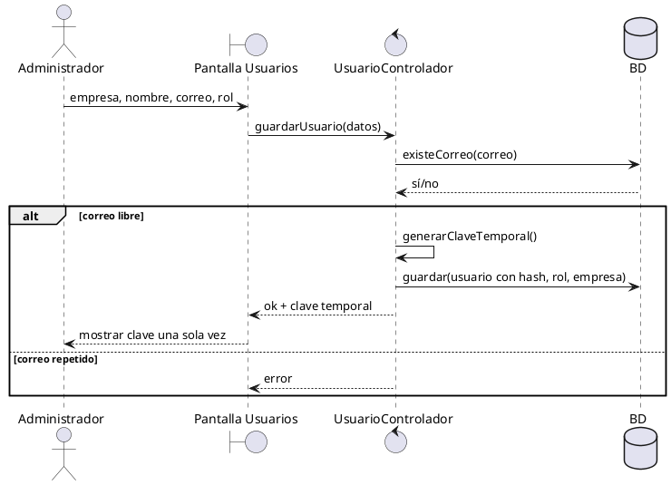

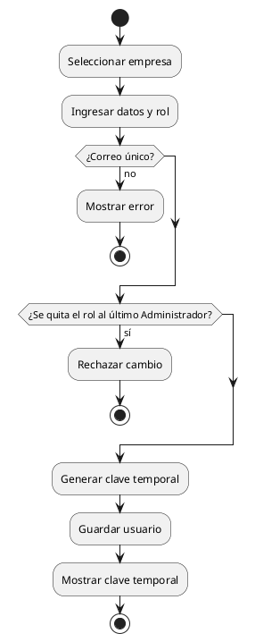

### CU04 · Registrar dispositivo

| | |
|---|---|
| **Actor** | Administrador |
| **Flujo básico** | 1. Ingresa nombre y empresa del dispositivo. 2. El sistema genera un token aleatorio. 3. Guarda solo su hash. 4. Muestra el token **una sola vez**. 5. El administrador lo carga en el firmware. 6. El dispositivo queda "sin conectar" hasta su primera telemetría (CU13) |
| **Alternos** | 2a. Regenerar token: el anterior queda inválido de inmediato |
| **Postcondición** | Dispositivo asociado a una empresa, con su credencial |

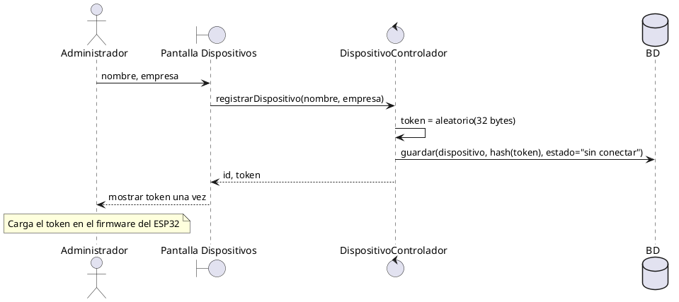

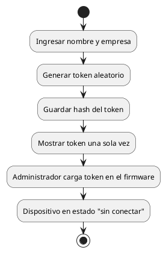

### CU05 · Registrar consumo facturado

| | |
|---|---|
| **Actor** | Técnico |
| **Flujo básico (manual)** | 1. Elige empresa y periodo. 2. Ingresa kWh y monto (Bs). 3. El sistema valida (valores > 0, periodo no repetido). 4. Guarda con el origen "facturado" |
| **Flujo alterno (Excel)** | 1. Sube un archivo con la plantilla. 2. El sistema valida fila por fila. 3. Muestra las filas válidas y las que tienen error. 4. El usuario confirma. 5. Se guardan solo las válidas |
| **Alternos** | 3a. Periodo ya cargado: se pregunta si reemplazar |
| **Postcondición** | Historial facturado actualizado |

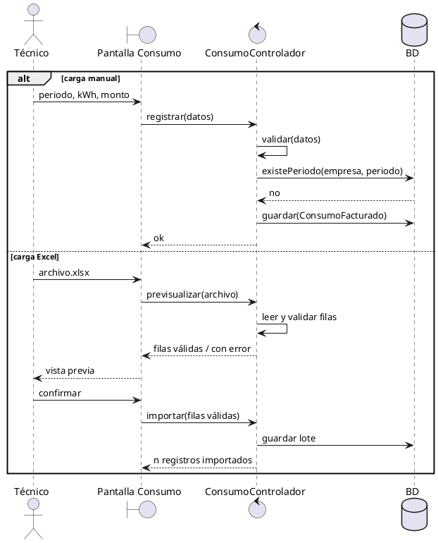

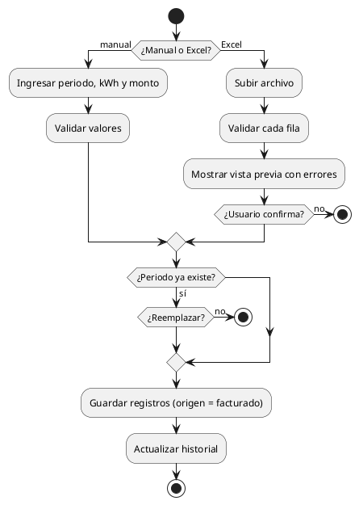

### CU06 · Consultar historial

| | |
|---|---|
| **Actor** | Consulta (y herederos) |
| **Flujo básico** | 1. Elige el tipo de dato: facturado, medido o conmutaciones. 2. Elige el periodo. 3. El sistema consulta solo los datos de **su** empresa. 4. Muestra gráfico y tabla con unidades (kWh, Bs, Wh, V, A) |
| **Alternos** | 3a. No hay datos: aviso "sin datos en el periodo" |
| **Reglas** | Lo medido y lo facturado nunca se suman en una misma serie (RNF12). Tiempo de respuesta ≤ 3 s (RNF03) |

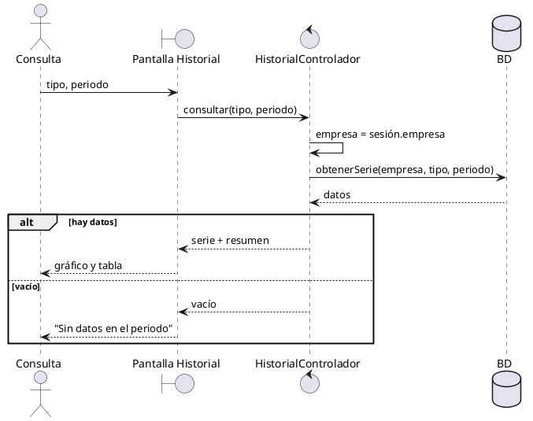

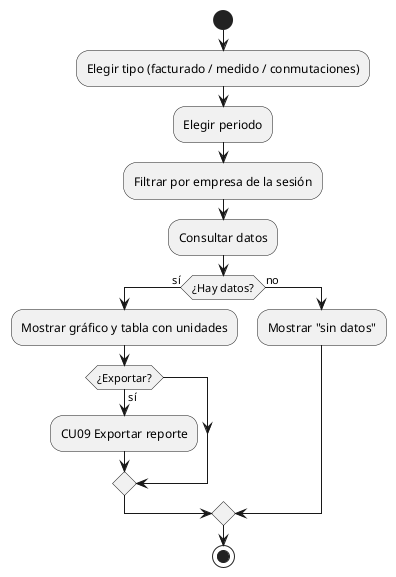

### CU07 · Configurar parámetros económicos

| | |
|---|---|
| **Actor** | Administrador (RNF06) |
| **Flujo básico** | 1. Edita tarifa (Bs/kWh), costo de instalación (Bs/kWp), generación solar estimada (kWh/kWp/mes) y mantenimiento (Bs/año). 2. El sistema valida rangos. 3. Guarda una **nueva versión**; la anterior se conserva para las simulaciones ya hechas |
| **Postcondición** | Parámetros vigentes actualizados sin modificar código |

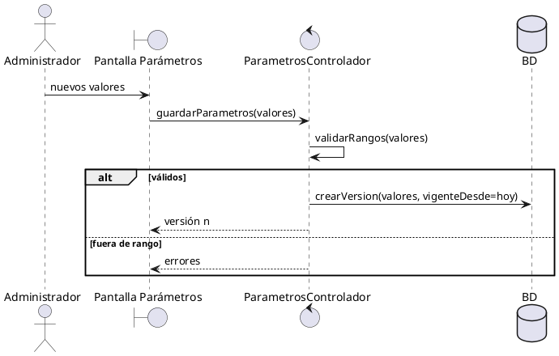

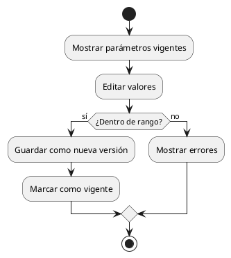

### CU08 · Simular y comparar escenarios

| | |
|---|---|
| **Actor** | Técnico |
| **Incluye** | CU07 (usa los parámetros vigentes) |
| **Flujo básico** | 1. Elige empresa y periodo base (consumo facturado o perfil medido). 2. Indica potencia solar a evaluar (kWp) y horizonte (años). 3. El sistema calcula red, solar y mixto: costo proyectado, ahorro acumulado y recuperación. 4. Muestra la comparación rotulada **SIMULACIÓN** con sus supuestos. 5. Puede guardarla |
| **Alternos** | 1a. Menos de 3 meses de datos: advierte baja confiabilidad |

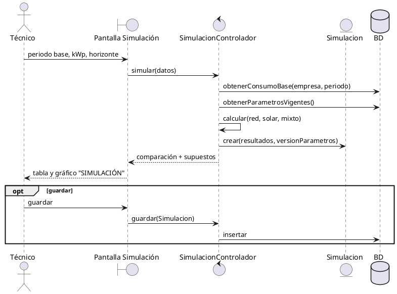

```plantuml
@startuml CU08_actividad
start
:Elegir periodo base y kWp;
:Obtener consumo base y parámetros vigentes;
if (¿Datos suficientes (≥ 3 meses)?) then (no)
  :Advertir baja confiabilidad;
endif
fork
  :Calcular escenario red;
fork again
  :Calcular escenario solar;
fork again
  :Calcular escenario mixto;
end fork
:Calcular ahorro y recuperación;
:Mostrar comparación rotulada SIMULACIÓN;
if (¿Guardar?) then (sí)
  :Guardar simulación con versión de parámetros;
endif
stop
@enduml
```

### CU09 · Exportar reporte

| | |
|---|---|
| **Actor** | Consulta (y herederos) |
| **Extiende** | CU06 y CU08 (botón "Exportar" en esas pantallas) |
| **Flujo básico** | 1. Pulsa Exportar. 2. Elige PDF o Excel. 3. El sistema genera el archivo con los filtros vigentes y la leyenda medido/simulado. 4. Lo descarga |

```plantuml
@startuml CU09_secuencia
actor Consulta
boundary "Pantalla Historial / Simulación" as UI
control "ReporteControlador" as C
database BD
Consulta -> UI : Exportar (formato)
UI -> C : generar(tipo, filtros, formato)
C -> BD : obtenerDatos(filtros)
C -> C : armarArchivo(formato)
C --> UI : archivo
UI --> Consulta : descarga
@enduml
```

```plantuml
@startuml CU09_actividad
start
:Pulsar Exportar;
:Elegir PDF o Excel;
:Obtener datos con los filtros actuales;
:Generar archivo con leyenda medido/simulado;
:Descargar;
stop
@enduml
```

### CU10 · Monitorear dispositivo

| | |
|---|---|
| **Actor** | Consulta (y herederos) |
| **Flujo básico** | 1. Abre el dispositivo. 2. La pantalla consulta el estado cada 2 s. 3. Muestra V, I y P por rama, Wh por fuente, modo, y fuente **solicitada / seleccionada / comprobada**, más la última conexión |
| **Alternos** | 3a. Última conexión hace más de 30 s: muestra "Sin conexión" y los últimos valores en gris |

```plantuml
@startuml CU10_secuencia
actor Consulta
boundary "Pantalla Monitoreo" as UI
control "MonitoreoControlador" as C
database BD
Consulta -> UI : abrir dispositivo
loop cada 2 s mientras la pantalla esté abierta
  UI -> C : estado(idDispositivo)
  C -> BD : últimaMedición + estado del dispositivo
  BD --> C : datos
  C --> UI : estado
  alt últimoContacto <= 30 s
    UI --> Consulta : valores en vivo
  else
    UI --> Consulta : "Sin conexión" (valores en gris)
  end
end
@enduml
```

```plantuml
@startuml CU10_actividad
start
:Abrir dispositivo;
repeat
  :Pedir estado;
  if (¿Contacto en los últimos 30 s?) then (sí)
    :Mostrar V, I, P, Wh, modo y
    fuente solicitada/seleccionada/comprobada;
  else (no)
    :Mostrar "Sin conexión";
  endif
  :Esperar 2 s;
repeat while (¿Pantalla abierta?)
stop
@enduml
```

### CU11 · Cambiar modo de fuente

| | |
|---|---|
| **Actor** | Técnico (y Administrador) |
| **Incluye** | CU13 (la orden viaja en la respuesta a la telemetría) |
| **Precondición** | Rol Técnico o superior; dispositivo de su empresa |
| **Flujo básico** | 1. Elige modo Solar, Cargador o Automático. 2. El sistema crea la orden "pendiente". 3. En la siguiente telemetría la entrega ("entregada"). 4. El dispositivo la ejecuta. 5. Informa "ejecutada". 6. La pantalla muestra el resultado |
| **Alternos** | 4a. Solar sin tensión suficiente: "rechazada" con motivo `solar_no_disponible`. 3a. No se entrega en 30 s: "expirada". 1a. Rol Consulta: botón deshabilitado y la API responde 403 |

```plantuml
@startuml CU11_secuencia
actor "Técnico" as T
boundary "Pantalla Monitoreo" as UI
control "OrdenControlador" as C
database BD
participant "Dispositivo SAGE" as D
T -> UI : elegir modo SOLAR
UI -> C : crearOrden(disp, SOLAR)
C -> C : verificarRol y empresa
C -> BD : insertar Orden(estado=pendiente)
C --> UI : orden 78 pendiente
D -> C : POST telemetría (CU13)
C -> BD : orden 78 → entregada
C --> D : { orden: 78, SOLAR }
D -> D : ¿solar >= V_retorno?
alt condición cumplida
  D -> D : PROBANDO_SOLAR → EN_SOLAR
  D -> C : POST telemetría { orden 78: ejecutada }
  C -> BD : orden 78 → ejecutada
else solar insuficiente
  D -> C : POST telemetría { orden 78: rechazada, solar_no_disponible }
  C -> BD : orden 78 → rechazada
end
UI -> C : estadoOrden(78) (cada 2 s)
C --> UI : resultado
UI --> T : "Ejecutada" o "Rechazada: solar no disponible"
@enduml
```

```plantuml
@startuml CU11_actividad
|Técnico|
start
:Elegir modo;
|Plataforma|
if (¿Rol Técnico+ y misma empresa?) then (no)
  :Responder 403;
  stop
endif
:Crear orden pendiente;
|Dispositivo|
:Recibir orden en la telemetría;
if (¿Orden válida y condiciones cumplidas?) then (sí)
  :Aplicar modo y conmutar;
  :Informar "ejecutada";
else (no)
  :Mantener estado;
  :Informar "rechazada" + motivo;
endif
|Plataforma|
:Actualizar orden y registrar evento;
|Técnico|
:Ver resultado;
stop
@enduml
```

### CU12 · Configurar reglas de conmutación

| | |
|---|---|
| **Actor** | Técnico |
| **Flujo básico** | 1. Edita V_min, V_retorno, I_min, T_falla, T_estable y T_prueba. 2. El sistema valida los límites de la tabla 4.1 del diseño y que V_retorno ≥ V_min + 0,2. 3. Crea una orden de tipo "parámetros" con versión n+1. 4. El dispositivo los aplica, los guarda en NVS y confirma la versión |
| **Alternos** | 2a. Fuera de límites: rechazado sin crear orden. 4a. El dispositivo rechaza (versión vieja): queda "rechazada" |

```plantuml
@startuml CU12_secuencia
actor "Técnico" as T
boundary "Pantalla Reglas" as UI
control "ReglasControlador" as C
database BD
participant "Dispositivo SAGE" as D
T -> UI : nuevos umbrales
UI -> C : guardarReglas(valores)
C -> C : validarLimites(valores)
alt válidos
  C -> BD : Orden(tipo=parametros, versión n+1)
  D -> C : POST telemetría
  C --> D : orden parámetros v n+1
  D -> D : validar, aplicar, guardar en NVS
  D -> C : POST { orden: ejecutada, version: n+1 }
  C -> BD : dispositivo.parametros_version = n+1
  C --> UI : aplicado
else fuera de límites
  C --> UI : errores
end
@enduml
```

```plantuml
@startuml CU12_actividad
start
:Editar umbrales y tiempos;
if (¿Dentro de límites y V_retorno ≥ V_min + 0,2?) then (no)
  :Mostrar errores;
  stop
endif
:Crear orden de parámetros (versión n+1);
:Entregar en la siguiente telemetría;
if (¿Dispositivo acepta?) then (sí)
  :Aplicar y guardar en NVS;
  :Confirmar versión;
else (no)
  :Marcar orden rechazada;
endif
stop
@enduml
```

### CU13 · Sincronizar telemetría y órdenes

| | |
|---|---|
| **Actor** | Dispositivo SAGE |
| **Flujo básico** | 1. Cada 2 s el dispositivo envía mediciones, eventos en cola y resultados de órdenes con su token. 2. El servidor autentica. 3. Guarda la medición y actualiza `ultimo_contacto`. 4. Inserta eventos descartando duplicados `(boot_id, seq)`. 5. Actualiza los resultados de órdenes. 6. Evalúa alertas y cierra la de "sin conexión" si estaba abierta. 7. Responde con la orden pendiente (y la marca "entregada") o `null` |
| **Alternos** | 2a. Token inválido: 401 y nada se guarda. 1a. Sin Wi-Fi: el dispositivo mantiene la cola y reintenta (CU14 sigue funcionando) |

```plantuml
@startuml CU13_secuencia
participant "Dispositivo SAGE" as D
control "TelemetriaControlador" as C
database BD
D -> C : POST /telemetria (token, mediciones, eventos, resultados)
C -> BD : buscarPorHash(token)
alt token válido
  C -> BD : insertar Medicion
  C -> BD : actualizar ultimo_contacto, estado
  C -> BD : insertar eventos (ignorar duplicados boot_id+seq)
  C -> BD : actualizar órdenes informadas
  C -> C : evaluarAlertas()
  C -> BD : siguienteOrdenPendiente(no expirada)
  BD --> C : orden o null
  opt hay orden
    C -> BD : orden → entregada
  end
  C --> D : 200 { hora_servidor, orden }
  D -> D : vaciar cola confirmada
else token inválido
  C --> D : 401
end
@enduml
```

```plantuml
@startuml CU13_actividad
|Dispositivo|
start
:Armar paquete (mediciones, cola de eventos, resultados);
if (¿Wi-Fi disponible?) then (no)
  :Conservar cola y reintentar en 2 s;
  stop
endif
:POST telemetría;
|Plataforma|
if (¿Token válido?) then (no)
  :Responder 401;
  stop
endif
:Guardar medición y último contacto;
:Insertar eventos sin duplicar;
:Actualizar resultados de órdenes;
:Evaluar alertas;
:Buscar orden pendiente no expirada;
:Responder con orden o null;
|Dispositivo|
:Vaciar eventos confirmados;
if (¿Llegó una orden?) then (sí)
  :Ejecutarla (CU11 / CU12);
endif
stop
@enduml
```

### CU14 · Conmutar fuente automáticamente

| | |
|---|---|
| **Actor** | Dispositivo SAGE (lógica local, sin plataforma) |
| **Precondición** | Modo Automático (o Solar, con la política D2) |
| **Flujo básico** | Aplica la tabla 4.2 del diseño: EN_CARGADOR → PROBANDO_SOLAR → EN_SOLAR, con histéresis, T_estable, T_prueba y espera creciente |
| **Alternos** | Ambas fuentes < V_min: SIN_ALIMENTACION, relé en cargador y alerta. Corriente < I_min: `sin_consumo` y decide solo por tensión |
| **Postcondición** | Cada cambio queda como evento en la cola (se envía por CU13) |

```plantuml
@startuml CU14_secuencia
participant "INA219 solar" as S1
participant "INA219 cargador" as S2
control "ControladorFuente\n(firmware)" as F
participant "Relé" as R
entity "ColaEventos" as Q
loop cada 100 ms
  F -> S1 : leer V, I
  F -> S2 : leer V, I
  F -> F : promediar 1 s, acumular Wh
end
alt EN_SOLAR y V_sol < V_min durante T_falla
  F -> R : NC (cargador)
  F -> Q : evento(SOLAR→CARGADOR, solar_insuficiente)
  F -> F : estado = EN_CARGADOR
else EN_CARGADOR, V_sol >= V_retorno durante T_estable y espera vencida
  F -> R : NO (solar)
  F -> F : estado = PROBANDO_SOLAR
  alt V_sol >= V_min durante T_prueba
    F -> Q : evento(CARGADOR→SOLAR, solar_comprobada)
    F -> F : estado = EN_SOLAR
  else falla durante la prueba
    F -> R : NC (cargador)
    F -> Q : evento(prueba_solar_fallida)
    F -> F : espera = min(espera × 2, 600 s)
  end
end
@enduml
```

```plantuml
@startuml CU14_estados
title CU14 · Máquina de estados (complementa la actividad)
[*] --> EN_CARGADOR : arranque (relé en reposo)
EN_CARGADOR --> PROBANDO_SOLAR : solar ≥ V_retorno por T_estable\ny espera vencida
EN_CARGADOR --> PROBANDO_SOLAR : cargador < V_min\ny solar ≥ V_retorno
PROBANDO_SOLAR --> EN_SOLAR : solar ≥ V_min por T_prueba
PROBANDO_SOLAR --> EN_CARGADOR : falla / espera × 2
EN_SOLAR --> EN_CARGADOR : solar < V_min por T_falla
EN_CARGADOR --> SIN_ALIMENTACION : ambas < V_min
EN_SOLAR --> SIN_ALIMENTACION : ambas < V_min
SIN_ALIMENTACION --> EN_CARGADOR : alguna fuente se recupera
@enduml
```

```plantuml
@startuml CU14_actividad
start
:Leer sensores y promediar 1 s;
:Acumular Wh de la fuente seleccionada;
if (¿Ambas fuentes < V_min?) then (sí)
  :Relé a cargador, estado SIN_ALIMENTACION;
  :Encolar alerta;
  stop
endif
if (¿Estado EN_SOLAR?) then (sí)
  if (¿Solar < V_min durante T_falla?) then (sí)
    :Relé a cargador;
    :Encolar evento solar_insuficiente;
  endif
else (EN_CARGADOR)
  if (¿Solar ≥ V_retorno por T_estable y espera vencida?) then (sí)
    :Relé a solar (PROBANDO_SOLAR);
    if (¿Sostiene la carga durante T_prueba?) then (sí)
      :Estado EN_SOLAR;
      :Encolar evento solar_comprobada;
    else (no)
      :Relé a cargador;
      :Duplicar espera;
      :Encolar evento prueba_solar_fallida;
    endif
  endif
endif
stop
@enduml
```

### CU15 · Atender alertas

| | |
|---|---|
| **Actor** | Técnico (Consulta solo las ve) |
| **Flujo básico** | 1. Ve la lista de alertas abiertas: tipo, dispositivo, inicio. 2. Abre una y ve los eventos relacionados. 3. La marca como **reconocida** con un comentario. 4. La alerta se **cierra sola** cuando desaparece la condición (CU13/CU16) |
| **Nota** | Este caso agrega dos campos al modelo de datos del diseño v1: `alerta.reconocida_por` y `alerta.reconocida_ts` |

```plantuml
@startuml CU15_secuencia
actor "Técnico" as T
boundary "Pantalla Alertas" as UI
control "AlertaControlador" as C
database BD
T -> UI : abrir alertas
UI -> C : listarAbiertas(empresa)
C -> BD : consultar
C --> UI : alertas
T -> UI : reconocer(alerta, comentario)
UI -> C : reconocer(id, comentario)
C -> BD : alerta.reconocida_por, reconocida_ts
C --> UI : ok
@enduml
```

```plantuml
@startuml CU15_actividad
start
:Listar alertas abiertas de la empresa;
:Abrir alerta y ver eventos relacionados;
if (¿Rol Técnico+?) then (sí)
  :Reconocer con comentario;
else (no)
  :Solo lectura;
endif
note right: La alerta se cierra sola\ncuando la condición desaparece
stop
@enduml
```

### CU16 · Detectar pérdida de comunicación

| | |
|---|---|
| **Actor** | Reloj del sistema (cada 10 s) |
| **Flujo básico** | 1. Busca dispositivos con `ultimo_contacto` de hace más de 30 s y sin alerta abierta. 2. Crea la alerta "sin conexión". 3. Marca como "expiradas" las órdenes pendientes con más de 30 s |
| **Cierre** | CU13 cierra la alerta cuando vuelve la telemetría |

```plantuml
@startuml CU16_secuencia
participant "Reloj del sistema" as R
control "VigilanteControlador" as C
database BD
loop cada 10 s
  R -> C : verificar()
  C -> BD : dispositivos con ultimo_contacto > 30 s y sin alerta abierta
  BD --> C : lista
  loop por cada dispositivo
    C -> BD : crear Alerta(sin_conexion)
  end
  C -> BD : órdenes pendientes de más de 30 s → expirada
end
@enduml
```

```plantuml
@startuml CU16_actividad
start
:Disparo del reloj (10 s);
:Buscar dispositivos sin contacto > 30 s;
while (¿Quedan dispositivos?) is (sí)
  if (¿Ya tiene alerta abierta?) then (no)
    :Crear alerta "sin conexión";
  endif
endwhile (no)
:Expirar órdenes pendientes > 30 s;
stop
@enduml
```

### CU17 · Registrar ensayo

| | |
|---|---|
| **Actor** | Técnico |
| **Flujo básico** | 1. Pulsa "Iniciar ensayo" e ingresa la carga (ej.: "lámpara LED USB 1 W") y las condiciones (ej.: "sol directo, 25 °C, panel 12 V 3 W"). 2. El sistema guarda el inicio. 3. Al terminar pulsa "Finalizar" y agrega notas. 4. El sistema asocia las mediciones del intervalo y calcula Wh por fuente, tiempo en cada fuente y número de conmutaciones |
| **Alternos** | 1a. Ya hay un ensayo abierto en ese dispositivo: no permite otro |

```plantuml
@startuml CU17_secuencia
actor "Técnico" as T
boundary "Pantalla Ensayos" as UI
control "EnsayoControlador" as C
database BD
T -> UI : iniciar(carga, condiciones)
UI -> C : iniciarEnsayo(disp, datos)
C -> BD : ¿ensayo abierto en disp?
alt no
  C -> BD : Ensayo(inicio = ahora)
  C --> UI : en curso
else sí
  C --> UI : error
end
... ensayo en curso ...
T -> UI : finalizar(notas)
UI -> C : finalizarEnsayo(id, notas)
C -> BD : fin = ahora
C -> BD : agregar mediciones y eventos [inicio, fin]
C --> UI : resumen (Wh por fuente, tiempo, conmutaciones)
@enduml
```

```plantuml
@startuml CU17_actividad
start
if (¿Hay ensayo abierto?) then (sí)
  :Mostrar error;
  stop
endif
:Ingresar carga y condiciones;
:Guardar inicio;
:Ensayo en curso (mediciones normales);
:Finalizar y escribir notas;
:Calcular Wh por fuente, tiempos y conmutaciones;
:Mostrar resumen;
stop
@enduml
```

### CU18 · Comparar fuentes medidas

| | |
|---|---|
| **Actor** | Consulta (y herederos) |
| **Flujo básico** | 1. Elige un ensayo o un periodo. 2. El sistema calcula, por fuente: Wh, % del tiempo, potencia media y número de conmutaciones (con sus motivos). 3. Muestra el resultado rotulado **MEDIDO**, separado de cualquier simulación |
| **Alternos** | 2a. Hay huecos de datos (dispositivo sin conexión): se informa el % de cobertura. Los Wh siguen siendo correctos porque el acumulado viene del dispositivo |

```plantuml
@startuml CU18_secuencia
actor Consulta
boundary "Pantalla Comparación" as UI
control "ComparacionControlador" as C
database BD
Consulta -> UI : ensayo o periodo
UI -> C : comparar(filtro)
C -> BD : mediciones y eventos del intervalo
C -> C : Wh por fuente (diferencia de acumulados por boot_id)
C -> C : % tiempo, potencia media, conmutaciones, cobertura
C --> UI : resultado
UI --> Consulta : comparación rotulada MEDIDO
@enduml
```

```plantuml
@startuml CU18_actividad
start
:Elegir ensayo o periodo;
:Obtener mediciones y eventos;
:Calcular Wh por fuente con acumulados por boot_id;
:Calcular % de tiempo, potencia media y conmutaciones;
if (¿Cobertura < 100 %?) then (sí)
  :Informar huecos de datos;
endif
:Mostrar comparación MEDIDO;
stop
@enduml
```

---

## 5. Diagrama de clases (dominio)

Es uno solo para todo el sistema, como es habitual. Refleja el modelo de datos del diseño v1, más `ConsumoFacturado` (RF03, que faltaba en v1) y los campos de reconocimiento de `Alerta` (CU15).

```plantuml
@startuml Clases
skinparam classAttributeIconSize 0
enum Rol {
  ADMINISTRADOR
  TECNICO
  CONSULTA
}
enum Modo {
  SOLAR
  CARGADOR
  AUTO
}
enum Fuente {
  SOLAR
  CARGADOR
  NINGUNA
}
enum EstadoOrden {
  PENDIENTE
  ENTREGADA
  EJECUTADA
  RECHAZADA
  EXPIRADA
}

class Empresa {
  -id: int
  -razonSocial: String
  -nit: String
  -rubro: String
  -activa: boolean
}
class Usuario {
  -id: int
  -nombre: String
  -correo: String
  -hashClave: String
  -rol: Rol
  -activo: boolean
  +tienePermiso(accion): boolean
}
class Dispositivo {
  -id: int
  -nombre: String
  -hashToken: String
  -firmware: String
  -ultimoContacto: DateTime
  -modoActual: Modo
  -estadoActual: String
  -fuenteSeleccionada: Fuente
  -alimentacionComprobada: boolean
  -parametrosVersion: int
  +estaConectado(): boolean
}
class ParametrosRegla {
  -version: int
  -vMin: float
  -vRetorno: float
  -iMinMa: float
  -tFallaS: float
  -tEstableS: float
  -tPruebaS: float
  +validarLimites(): boolean
}
class Medicion {
  -bootId: int
  -seq: long
  -ts: DateTime
  -tsValida: boolean
  -vSol: float
  -iSolMa: float
  -pSolMw: float
  -whSolAcum: float
  -vCar: float
  -iCarMa: float
  -pCarMw: float
  -whCarAcum: float
  -fuenteSeleccionada: Fuente
  -alimentacionComprobada: boolean
}
class Evento {
  -bootId: int
  -seq: long
  -ts: DateTime
  -tipo: String
  -de: Fuente
  -a: Fuente
  -motivo: String
  -origen: String
}
class Orden {
  -id: int
  -tipo: String
  -valor: String
  -estado: EstadoOrden
  -motivo: String
  -creada: DateTime
  -entregada: DateTime
  -resuelta: DateTime
  +expirar(): void
}
class Alerta {
  -tipo: String
  -inicio: DateTime
  -fin: DateTime
  -reconocidaTs: DateTime
  +cerrar(): void
  +reconocer(u: Usuario, comentario): void
}
class Ensayo {
  -inicio: DateTime
  -fin: DateTime
  -carga: String
  -condiciones: String
  -notas: String
  +resumen(): ResumenFuentes
}
class ConsumoFacturado {
  -periodo: YearMonth
  -kWh: float
  -montoBs: float
  -origen: String
}
class ParametrosEconomicos {
  -version: int
  -tarifaBsKWh: float
  -costoInstalacionBsKWp: float
  -generacionKWhKWpMes: float
  -mantenimientoBsAnio: float
  -vigenteDesde: Date
}
class Simulacion {
  -fecha: DateTime
  -kWp: float
  -horizonteAnios: int
  -resultadoRed: float
  -resultadoSolar: float
  -resultadoMixto: float
  -recuperacionAnios: float
}

Empresa "1" *-- "0..*" Usuario
Empresa "1" *-- "0..*" Dispositivo
Empresa "1" *-- "0..*" ConsumoFacturado
Empresa "1" *-- "0..*" Simulacion
Dispositivo "1" *-- "0..*" Medicion
Dispositivo "1" *-- "0..*" Evento
Dispositivo "1" *-- "0..*" Orden
Dispositivo "1" *-- "0..*" Alerta
Dispositivo "1" *-- "0..*" Ensayo
Dispositivo "1" --> "1" ParametrosRegla : vigentes
Usuario "1" --> "0..*" Orden : emite
Usuario "1" --> "0..*" Ensayo : registra
Usuario "0..1" --> "0..*" Alerta : reconoce
Orden "0..1" <-- "0..*" Evento : origina
Simulacion "0..*" --> "1" ParametrosEconomicos : usa versión
@enduml
```

---

## 6. Trazabilidad requisitos → casos de uso

| Requisito | CU |
|---|---|
| RF01 | CU02 |
| RF02 | CU03 |
| RF03 | CU05 |
| RF04 | CU06 |
| RF05 | CU07 |
| RF06, RF07 | CU08 |
| RF08 | CU09 |
| RF09 | CU04 |
| RF10 | CU10, CU13 |
| RF11 | CU11, CU13 |
| RF12 | CU14 |
| RF13 | CU13, CU14 |
| RF14 | CU10, CU13 |
| RF15 | CU12 |
| RF16 | CU15, CU16 |
| RF17 | CU17 |
| RF18 | CU18 |
| RNF01 | CU01 y verificación de rol en todos |
| RNF06 | CU07, CU12 |
| RNF07 | CU14 |
| RNF08 | CU04, CU11, CU13, CU16 |
| RNF12 | CU06, CU08, CU10, CU18 |
